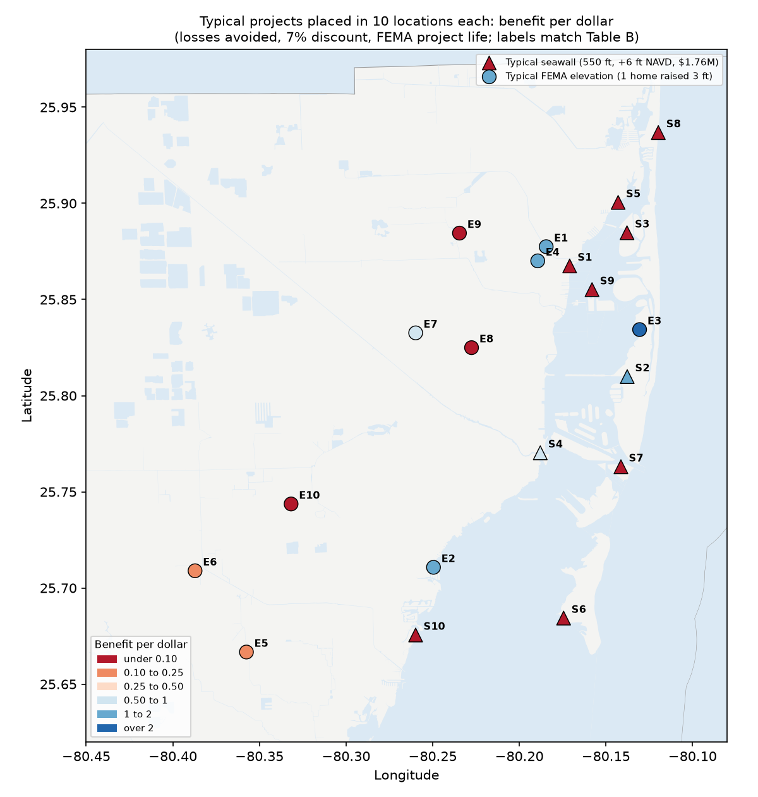

# What do typical funded flood projects return per dollar? (Part 2)

Benefit simulator. 16 Nov 2026. Branch `benefit-simulator`. Decisions D-196
and D-197 in `DECISIONS.md`. Scripts `scripts/benefit/typical_elevation_hma.py`
and `scripts/benefit/typical_projects_part2.py`; results in
`outputs/benefit/typical_projects/` (`part2_real_projects.csv`,
`part2_typical_placements.csv`, `part2_seawall_scan.csv`,
`hma_elevation_summary.json`, `part2_summary.json`).

## Sources

| Source | What we used | Date of data | How we got it |
|---|---|---|---|
| SCALE-R resilience investment database, Part 1 classification (D-196) | Real seawall and elevation projects, their place, cost and size; typical seawall | Projects reported 2003 to 2026 | Already in the repo |
| FEMA OpenFEMA, HMA Subapplications v2, Florida rows (5,291) | Funded elevation projects in Florida: homes per project and cost per home | Fiscal years 1996 to 2025; refreshed 27 Jul 2026 | Downloaded 16 Nov 2026 (user approved; replaces "HMA Projects", which OpenFEMA no longer serves) |
| FDEM, Elevate Florida programme snapshot, May 2025 | Second elevation case: about $267,000 per home | May 2025 | Read online in Part 1 |
| FEMA BCA Toolkit help content, Aug 2025 | 7% discount rate for new BCAs (PDF page 59) | 2025 | Already on disk |
| FEMA BCA Project Configuration and Cost Estimation Methodology Report, July 2025 | Project useful life: 50 years for floodwalls and concrete infrastructure, 30 years for residential elevation (Table 1, page 16) | 2025 | Already on disk |
| BLS CPI-U, annual | Costs in 2025 dollars | to 2025 | Already on disk (D-144) |
| Modules A to C (FEMA 2027 water levels, USACE damage curves, NSI buildings) | Expected yearly damage before and after each project | 2026 build | Already in the repo |
| Module D coefficients and Florida tax rules | Tax change, with the published Miami price discount scenario (D-187) | 2026 tax roll | Already in the repo |

**Estimated** means calculated from data. **Assumed** means a rule or
input we chose; each one is listed in section 5.

## 1. In short

- **Most flood spending is not what Module C can model yet.** Seawalls and
  home elevation are only about 5% of flood projects and 3% of flood
  spending in our database; drainage, canals and pumps are most of it and
  need the rainfall data.
- **A typical home elevation** (FEMA's South Florida median: 1 home,
  about $254,000, raised 3 ft) **pays back where homes already flood
  often.** Placed on the most damaged home in four high-damage
  neighbourhoods (Biscayne Park, Miami, Miami Beach, Miami Shores) it
  avoids $26,000 to $50,000 a year and returns **$1.26 to $2.45 per
  dollar**. In middle-damage places it returns $0.10 to $0.58, and in
  low-damage places almost nothing (estimated).
- **Raising 10 homes at once** (the Elevate Florida case, an assumption)
  returns less per dollar, $0.67 to $0.99 in the same high-damage places,
  because the 2nd to 10th homes flood less than the first.
- **A typical seawall** (550 ft, crest +6.0 ft NAVD, $1.76M) **rarely
  pays back in our model.** The median placement avoids about $400 a
  year. Only one of the 10 placements (Miami Beach, $229,000 a year,
  $1.58 per dollar) clears $1. Across all 443 possible 550 ft stretches
  of the coastal shoreline with damage behind them, 6 (all in Miami
  Beach) clear $1. The reason: FEMA's 2027 storm levels are above +6 ft
  along most of the shore, so a +6 ft wall is overtopped in most storms
  that cause damage. **At +8 ft the same walls return $2.58 to $8.68 in
  the four high-damage places** (sensitivity, not a funded design).
- **Real projects from our database.** Of the 12 shoreline seawalls, 7
  sit on rivers or inner waterways that FEMA's coastal study does not
  follow, so they could not be modelled; the other 5 avoid little at
  +6 ft ($0.00 to $0.15 per dollar). The 5 PortMiami bulkheads and 4 canal
  or lake walls protect no modelled homes from bay surge. The one
  elevation project (2 homes in Miami Beach, $820,682) returns **$1.14
  per dollar**.
- **Where the best returns are:** homes and shorelines in Miami Beach and
  the low-lying bayfront of northeast Miami-Dade, where frequent storms
  already flood buildings. Inland places look poor partly because
  rainfall flooding is modelled only in the C-8 and C-9 basins (section 5).

## 2. How the runs were set up

**Typical elevation project (estimated, FEMA HMA data).** Of 955 Florida
elevation subapplications, we dropped 40 withdrawn or void, 216 denied,
not selected or ineligible, 206 still pending or in review, 2 with no
building count and 35 with zero cost. That leaves 456 funded projects in
Florida, 13 in South Florida (Miami-Dade, Broward, Palm Beach, Monroe) and
1 in Miami-Dade. South Florida has at least 10, so it sets the typical
project:

| | Florida (456) | South Florida (13, used) | Miami-Dade (1) |
|---|---|---|---|
| Homes per project, median (middle half) | 1 (1 to 1) | **1 (1 to 1)** | 1 |
| Cost per home, 2025, median (middle half) | $326,706 ($202,097 to $461,150) | **$253,859 ($221,422 to $381,735)** | $741,878 |
| Projects with one home | 79% | 77% | 1 of 1 |
| Fiscal years | 1996 to 2025 | 1999 to 2023 | 2008 |

FEMA elevation grants are almost always for one home at a time. Florida
projects since 2018 cost more (median $429,150 per home, 185 projects),
so the South Florida median, which includes older projects, may be on
the low side.

**Typical seawall** (Part 1, estimated): 550 ft, crest +6.0 ft NAVD,
$1.76M (middle half $0.56M to $2.74M). At $3,500 per foot, 550 ft would
cost $1.93M, so the two agree.

**Placing the projects.**
- Seawall: the wall is laid along FEMA's 2027 coastal shoreline (the
  transect baseline). It protects buildings whose line to the nearest
  shoreline point crosses the wall and whose ground is below the crest,
  for storms whose coastal water level is below the crest (Module C).
- Real seawalls are centred on the project point. Length is as stated,
  otherwise cost divided by $3,500 per foot, limited to the shoreline line
  there. Projects more than 500 m from that shoreline are not run.
- Elevation: the homes with the highest expected yearly damage in the
  area are raised 3 ft, up to the number funded.
- Table B locations: shoreline stretches (every 250 m) and census tracts
  were ranked by expected yearly damage, and 4 high, 3 middle and 3 low
  were picked, one per place. Elevation alternates coastal and inland
  where it can.

**Benefit per dollar** = present value of losses avoided over the project
life / (cost + present value of maintenance). 7% discount rate; 50 years
for seawalls (present value factor 13.80) and 30 years for elevation
(12.41); maintenance 1% of cost a year for seawalls, none for elevation.
Tax change and property value change are kept out of the ratio. "Range"
is the spread across the low, middle and high damage curves; for Table B
we also show the ratio at the 25th and 75th percentile cost.

## 3. Table A: real projects at their real locations (estimated)

Protected means buildings whose expected yearly damage goes down;
residents are night-time residents of those buildings (NSI).

### Shoreline seawalls (12), the elevation project, then port and canal walls shown separately (9)

| Project | Name | Place | Kind | Size used | Cost (2025) | Protected: buildings / residents | Losses avoided a year, middle (range) | Benefit per dollar, middle (range) | Same wall at +8 ft (sensitivity) | Tax change, year 1 |
|---|---|---|---|---|---|---|---|---|---|---|
| SCALER-0003 | Yacht Club Drive Seawall Repairs | Aventura | shoreline | 140 ft (cost / $3,500 per ft) | $491,000 | not run: 1.1 km from the coastal shoreline |  |  |  |  |
| SCALER-0996 | Crandon Park U-Shape Seawall | Miami-Dade County | shoreline | 914 ft (cost / $3,500 per ft) | $3.20M | 0 / 0 | $0 ($0 to $0) | 0.00 (0.00 to 0.00) | 0.00 | $0 |
| SCALER-0994 | Crandon Park Marina North and South Seawalls Replacement Project | Miami-Dade County | shoreline | 503 ft (cost / $3,500 per ft) | $1.76M | 1 / 0 | $198 ($0 to $2,340) | 0.00 (0.00 to 0.02) | 0.04 | $0 |
| SCALER-0988 | Deering Estate Boat Basin New Seawall | Miami-Dade County | shoreline | 1,674 ft (cost / $3,500 per ft) | $5.86M | 0 / 0 | $0 ($0 to $0) | 0.00 (0.00 to 0.00) | 0.00 | $0 |
| SCALER-1333 | Pelican Harbor Marina Seawall Replacement | Miami-Dade County | shoreline | 782 ft (cost / $3,500 per ft) | $2.74M | 22 / 45 | $15,175 ($211 to $248,801) | 0.07 (0.00 to 1.10) | 1.86 | $11 |
| SCALER-0614 | Vizcaya Museum and Gardens Seawalls | Miami | shoreline | 160 ft (cost / $3,500 per ft) | $558,528 | 0 / 0 | $0 ($0 to $0) | 0.00 (0.00 to 0.00) | 0.00 | $0 |
| SCALER-0613 | Resilient Shoreline Stabilization at Kristi House Children’s Center | Miami | shoreline | 550 ft (stated) | $1.54M | not run: 2.9 km from the coastal shoreline |  |  |  |  |
| SCALER-0681 | Seawalls: Convention Center Dr to Washington | Miami Beach | shoreline | 611 ft (cost / $3,500 per ft) | $2.14M | not run: 0.6 km from the coastal shoreline |  |  |  |  |
| SCALER-0388 | Homestead Bayfront Marina Seawall Replacement | Homestead | shoreline | 593 ft (cost / $3,500 per ft) | $2.08M | 1 / 0 | $1,252 ($0 to $6,274) | 0.01 (0.00 to 0.04) | 0.01 | $0 |
| SCALER-0077 | Town of Bay Harbor Islands Seawall Replacement | Bay Harbor Islands | shoreline | 75 ft (stated) | $261,706 | 3 / 4 | $3,175 ($0 to $25,896) | 0.15 (0.00 to 1.20) | 43.44 | $11 |
| SCALER-0012 | NE 213th & NE 183rd Street Seawall | Aventura | shoreline | 493 ft (cost / $3,500 per ft) | $1.73M | not run: 0.6 km from the coastal shoreline |  |  |  |  |
| SCALER-0473 | North Grapeland Heights Seawall | Miami | shoreline | 102 ft (cost / $3,500 per ft) | $356,406 | not run: 5.9 km from the coastal shoreline |  |  |  |  |
| SCALER-0684 | Elevation of 2 Repetitive Loss Private Properties | Miami Beach | elevation | 2 homes raised 3 ft | $820,682 | 2 / 4 | $75,538 ($44,429 to $111,263) | 1.14 (0.67 to 1.68) |  | $0 |
| SCALER-0886 | Berth 10 Bulkhead Resiliency | Miami-Dade County | port bulkhead | 5,732 ft (cost / $3,500 per ft) | $20.06M | 0 / 0 | $0 ($0 to $367) | 0.00 (0.00 to 0.00) | 0.00 | $0 |
| SCALER-0887 | South Bulkhead Repairs (Bays 165-177) | Miami-Dade County | port bulkhead | 1,440 ft (stated) | $17.98M | 0 / 0 | $0 ($0 to $0) | 0.00 (0.00 to 0.00) | 0.00 | $0 |
| SCALER-0971 | North Bulkhead Improvement Project (PortMiami) | Miami-Dade County | port bulkhead | 17,594 ft (cost / $3,500 per ft) | $61.58M | 0 / 0 | $0 ($0 to $367) | 0.00 (0.00 to 0.00) | 0.00 | $0 |
| SCALER-1182 | Concrete Panels - Miami SeaPort | Miami-Dade County | port bulkhead | 220 ft (cost / $3,500 per ft) | $771,041 | 0 / 0 | $0 ($0 to $0) | 0.00 (0.00 to 0.00) | 0.00 | $0 |
| SCALER-1269 | Construction of New Seawall - Area 2 | Miami-Dade County | port bulkhead | 3,412 ft (cost / $3,500 per ft) | $11.94M | 0 / 0 | $0 ($0 to $0) | 0.00 (0.00 to 0.00) | 0.02 | $0 |
| SCALER-0456 | Lakeside Seawall LS-0304 | Medley | canal or lake edge | 202 ft (cost / $3,500 per ft) | $708,147 | not run: 16.4 km from the coastal shoreline |  |  |  |  |
| SCALER-0454 | Tobie Wilson Park New Seawall PR-1302 | Medley | canal or lake edge | 230 ft (cost / $3,500 per ft) | $804,840 | not run: 13.1 km from the coastal shoreline |  |  |  |  |
| SCALER-0440 | TWP Canal C-6 Bulkhead - Segment 2 Project 0214-2 | Medley | canal or lake edge | 953 ft (cost / $3,500 per ft) | $3.34M | not run: 13.8 km from the coastal shoreline |  |  |  |  |
| SCALER-1099 | Belen Phase I Drainage Improvements | Miami-Dade County | canal or lake edge | 472 ft (cost / $3,500 per ft) | $1.65M | not run: 15.4 km from the coastal shoreline |  |  |  |  |

- 7 shoreline seawalls were not run: they sit on the Miami River and its
  side waterways, inner waterways of Aventura, or the Collins Canal, 0.6 to 5.9 km from FEMA's
  coastal shoreline. Module C would otherwise move them to the open
  shore, which would be wrong.
- Of the 5 that ran, only Pelican Harbor Marina (22 buildings behind it)
  and Bay Harbor Islands protect a measurable amount at +6 ft.
- The Bay Harbor Islands wall is 75 ft long, but the model credits it
  with every building whose nearest shoreline point falls on those 75 ft.
  In reality water would go round a short wall, so its +8 ft result
  (43 per dollar) is not believable. Short walls are overstated by the
  model.
- Port bulkheads: lengths from cost / $3,500 per ft are far too long for
  heavy port structures (about $12,500 per ft, Part 1), but no modelled
  homes sit behind them at any length, so the result (no losses avoided)
  does not change. Their purpose is port operations, not home flood
  protection.
- Canal and lake walls in Medley and the C-4 (Belen) protect against canal
  water. Module C has canal and rainfall flood levels only in the C-8 and
  C-9 basins, so they cannot be valued yet.

All 12 shoreline seawalls together cost $22.7M and avoid about $19,800 a
year at +6 ft ($0.01 per dollar).

## 4. Table B: typical projects placed in 10 locations each (estimated)

"Expected yearly damage before" is for the buildings the project can
reach: for seawalls, buildings on that stretch of shore with coastal
flooding and ground below the crest; for elevation, the homes raised.

#### typical seawall

| ID | Place | Damage band | Coastal or inland | Expected yearly damage before (buildings in play) | Protected: buildings / residents | Losses avoided a year, middle (range) | Benefit per dollar, middle | Range from damage curves | Range from cost (75th to 25th percentile) | At +8 ft crest (sensitivity) | Tax change, year 1 | Rainfall levels modelled here |
|---|---|---|---|---|---|---|---|---|---|---|---|---|
| S1 | Miami Shores | high | coastal | $3.21M | 2 / 5 | $888 ($0 to $27,941) | 0.01 | 0.00 to 0.19 | 0.00 to 0.02 | 2.58 | $0 | no |
| S2 | Miami Beach | high | coastal | $1.42M | 119 / 210 | $228,964 ($20,003 to $1.47M) | 1.58 | 0.14 to 10.15 | 1.01 to 4.96 | 8.68 | $9,435 | no |
| S3 | Unincorporated Miami-Dade | high | coastal | $1.32M | 3 / 4 | $3,175 ($0 to $25,896) | 0.02 | 0.00 to 0.18 | 0.01 to 0.07 | 6.50 | $11 | no |
| S4 | Miami | high | coastal | $1.02M | 27 / 138 | $82,820 ($21,419 to $547,175) | 0.57 | 0.15 to 3.77 | 0.37 to 1.79 | 3.10 | $1,305 | no |
| S5 | North Miami | middle | coastal | $32,475 | 0 / 0 | $0 ($0 to $0) | 0.00 | 0.00 to 0.00 | 0.00 to 0.00 | 0.15 | $0 | no losses avoided |
| S6 | Key Biscayne | middle | coastal | $47,918 | 0 / 0 | $0 ($0 to $0) | 0.00 | 0.00 to 0.00 | 0.00 to 0.00 | 0.01 | $0 | no losses avoided |
| S7 | Fisher Island | middle | coastal | $46,730 | 4 / 3 | $5,804 ($262 to $101,358) | 0.04 | 0.00 to 0.70 | 0.03 to 0.13 | 0.20 | $0 | no |
| S8 | Sunny Isles Beach | low | coastal | $311 | 0 / 0 | $0 ($0 to $0) | 0.00 | 0.00 to 0.00 | 0.00 to 0.00 | 0.00 | $0 | no losses avoided |
| S9 | North Bay Village | low | coastal | $387 | 0 / 0 | $0 ($0 to $170) | 0.00 | 0.00 to 0.00 | 0.00 to 0.00 | 0.00 | $0 | no losses avoided |
| S10 | Coral Gables | low | coastal | $826 | 0 / 0 | $0 ($0 to $0) | 0.00 | 0.00 to 0.00 | 0.00 to 0.00 | 0.00 | $0 | no losses avoided |

#### typical elevation, FEMA HMA South Florida

| ID | Place | Damage band | Coastal or inland | Expected yearly damage before (buildings in play) | Protected: buildings / residents | Losses avoided a year, middle (range) | Benefit per dollar, middle | Range from damage curves | Range from cost (75th to 25th percentile) | Tax change, year 1 | Rainfall levels modelled here |
|---|---|---|---|---|---|---|---|---|---|---|---|
| E1 | Biscayne Park | high | coastal | $42,167 | 1 / 2 | $31,310 ($27,262 to $31,310) | 1.53 | 1.33 to 1.53 | 1.02 to 1.75 | $0 | yes (C-8 or C-9) |
| E2 | Miami | high | coastal | $45,455 | 1 / 3 | $29,661 ($16,884 to $35,056) | 1.45 | 0.83 to 1.71 | 0.96 to 1.66 | $6,865 | no |
| E3 | Miami Beach | high | coastal | $66,969 | 1 / 3 | $50,163 ($31,455 to $77,760) | 2.45 | 1.54 to 3.80 | 1.63 to 2.81 | $0 | no |
| E4 | Miami Shores | high | coastal | $38,691 | 1 / 2 | $25,754 ($22,809 to $27,373) | 1.26 | 1.11 to 1.34 | 0.84 to 1.44 | $0 | yes (C-8 or C-9) |
| E5 | Kendall | middle | coastal | $3,957 | 1 / 4 | $2,104 ($1,580 to $2,830) | 0.10 | 0.08 to 0.14 | 0.07 to 0.12 | $0 | no |
| E6 | Kendale Lakes | middle | inland | $3,117 | 1 / 2 | $3,117 ($500 to $7,515) | 0.15 | 0.02 to 0.37 | 0.10 to 0.17 | $713 | no |
| E7 | Hialeah | middle | coastal | $13,122 | 1 / 4 | $11,942 ($6,831 to $14,670) | 0.58 | 0.33 to 0.72 | 0.39 to 0.67 | $0 | no |
| E8 | Brownsville | low | inland | $77 | 1 / 4 | $77 ($6 to $293) | 0.00 | 0.00 to 0.01 | 0.00 to 0.00 | $0 | no |
| E9 | Westview | low | coastal | $596 | 1 / 2 | $596 ($133 to $1,193) | 0.03 | 0.01 to 0.06 | 0.02 to 0.03 | $0 | no |
| E10 | Westchester | low | inland | $237 | 1 / 3 | $237 ($28 to $526) | 0.01 | 0.00 to 0.03 | 0.01 to 0.01 | $92 | no |

#### elevation, Elevate Florida assumption

| ID | Place | Damage band | Coastal or inland | Expected yearly damage before (buildings in play) | Protected: buildings / residents | Losses avoided a year, middle (range) | Benefit per dollar, middle | Range from damage curves | Tax change, year 1 | Rainfall levels modelled here |
|---|---|---|---|---|---|---|---|---|---|---|
| E1 | Biscayne Park | high | coastal | $333,916 | 10 / 23 | $212,631 ($199,145 to $212,631) | 0.99 | 0.93 to 0.99 | $2,592 | yes (C-8 or C-9) |
| E2 | Miami | high | coastal | $255,980 | 10 / 20 | $144,516 ($123,747 to $189,920) | 0.67 | 0.58 to 0.88 | $10,626 | no |
| E3 | Miami Beach | high | coastal | $228,349 | 10 / 19 | $198,564 ($120,571 to $285,505) | 0.92 | 0.56 to 1.33 | $12,120 | no |
| E4 | Miami Shores | high | coastal | $225,846 | 10 / 24 | $200,271 ($104,635 to $284,045) | 0.93 | 0.49 to 1.32 | $9,795 | yes (C-8 or C-9) |
| E5 | Kendall | middle | coastal | $26,593 | 10 / 26 | $19,719 ($17,159 to $24,152) | 0.09 | 0.08 to 0.11 | $264 | no |
| E6 | Kendale Lakes | middle | inland | $21,933 | 10 / 31 | $21,933 ($5,409 to $43,945) | 0.10 | 0.03 to 0.20 | $1,779 | no |
| E7 | Hialeah | middle | coastal | $26,548 | 10 / 33 | $24,406 ($12,971 to $32,889) | 0.11 | 0.06 to 0.15 | $1,686 | no |
| E8 | Brownsville | low | inland | $609 | 10 / 34 | $609 ($28 to $2,003) | 0.00 | 0.00 to 0.01 | $136 | no |
| E9 | Westview | low | coastal | $3,790 | 10 / 31 | $3,790 ($973 to $7,889) | 0.02 | 0.00 to 0.04 | $406 | no |
| E10 | Westchester | low | inland | $1,679 | 10 / 32 | $1,679 ($33 to $4,776) | 0.01 | 0.00 to 0.02 | $218 | no |

*Map: triangles are the typical seawall (S1 to S10), circles the typical
FEMA elevation (E1 to E10); colour is benefit per dollar, middle
estimate. The Elevate Florida case uses the same places as E1 to E10.*

**Across the whole coastline (estimated).** We ran the typical seawall on
all 443 stretches of FEMA's coastal shoreline that have damaged
buildings behind them (`part2_seawall_scan.csv`):
- 161 (36%) avoid any loss at all;
- 9 (2%) return at least $0.50 per dollar, and 6 (1.4%) at least $1, all
  in Miami Beach (best: $2.71);
- the stretches with the most damage behind them are not always the best:
  the two are only loosely related (correlation 0.48), because what
  matters is how much damage comes from storms below the crest.

**What drives the results.**
- Elevation pays where the raised home floods in frequent storms. In the
  four high-damage tracts the most damaged home has expected damage of
  $39,000 to $67,000 a year; raising it 3 ft removes most of that.
- Seawalls pay only where frequent storms stay below the crest and many
  low-lying buildings sit directly behind the wall. At +6 ft this is rare
  under FEMA's 2027 storm levels; at +8 ft it is common in the
  high-damage places.
- Tax change is small and separate: up to about $12,000 in year 1 for an
  Elevate Florida group and $9,400 for the best seawall placement, under
  the published Miami price discount scenario (assumption). Homesteaded
  homes often show $0 in year 1 because Save Our Homes caps their
  assessed value.

## 5. What is estimated and what is assumed

| Item | Estimated or assumed | Note |
|---|---|---|
| Expected yearly damage before and after (Modules A to C) | Estimated | FEMA 2027 water levels, USACE damage curves, NSI buildings; low, middle and high curves give the ranges |
| Typical seawall size and cost | Estimated, weak | Length from 5 projects, crest from 2, cost from 13 (Part 1) |
| Typical elevation size and cost | Estimated | 13 funded South Florida FEMA projects; older projects pull the cost down |
| Elevate Florida case (10 homes, $267,000 each) | Assumed | Rough figure from a programme snapshot |
| Raise height 3 ft | Assumed | Module C default; FEMA projects usually raise to the base flood elevation plus freeboard, which may be more for deeply flooded homes |
| Crest +6.0 ft NAVD | Assumed from 2 projects | +8 ft shown as a sensitivity only |
| Seawall length when not stated | Assumed rule | Cost / $3,500 per ft, limited to the shoreline line there |
| Which homes are raised | Assumed rule | The most damaged single-family homes in the area (user's rule) |
| Discount rate 7%, project life 50 and 30 years | Assumed (FEMA standard) | FEMA BCA sources in the table above |
| Maintenance 1% a year for seawalls, none for elevation | Assumed | FEMA gives no standard rate |
| Tax change | Estimated with an assumed price effect | Published Miami discount scenario (D-187); our own condo coefficient is not reliable (Module D report) |

**Rainfall flooding we do not have.** Module C has rainfall and canal
flood levels only in the C-8 and C-9 basins (northeast Miami-Dade);
elsewhere it uses coastal levels and the FEMA map flood elevation. Of the
Table B elevation places, only Biscayne Park (E1) and Miami Shores (E4)
are in those basins. Elsewhere, and especially inland (Kendale Lakes,
Brownsville, Westchester), damage from heavy rain is missing, so
elevation benefits there are likely understated. Seawalls do not stop
rainfall flooding, so missing rainfall mostly leaves their results
unchanged; where rain floods a building deeper than the sea would, the
wall's benefit could be slightly overstated.

**Other limits.**
- Water going around the ends of a wall is not modelled, so short walls
  are overstated.
- Seawall benefits count buildings only, not roads, parks or utilities.
- Each placement is judged alone; neighbouring walls that close a gap
  together are not modelled.
- No sea level rise in these runs. Sea level rise would raise storm
  levels and overtop a +6 ft wall even more often.
